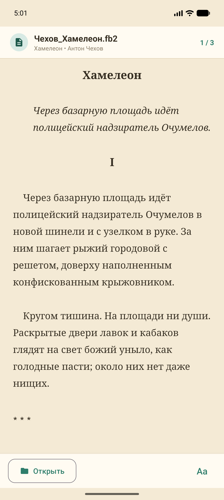
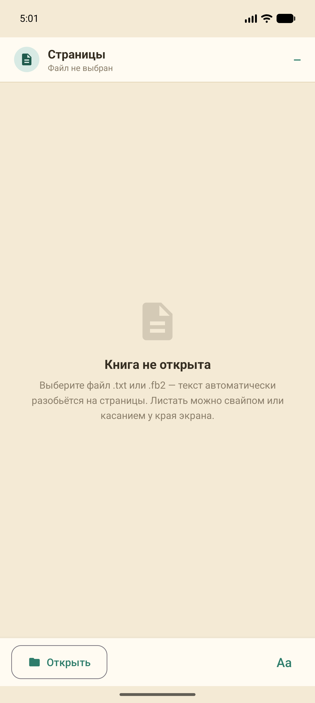
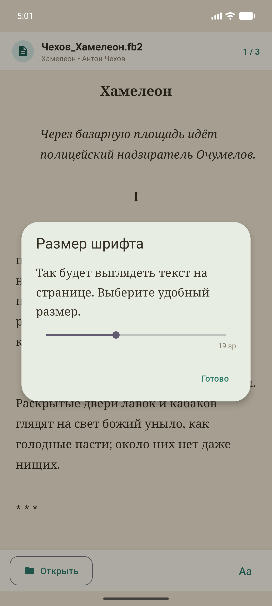
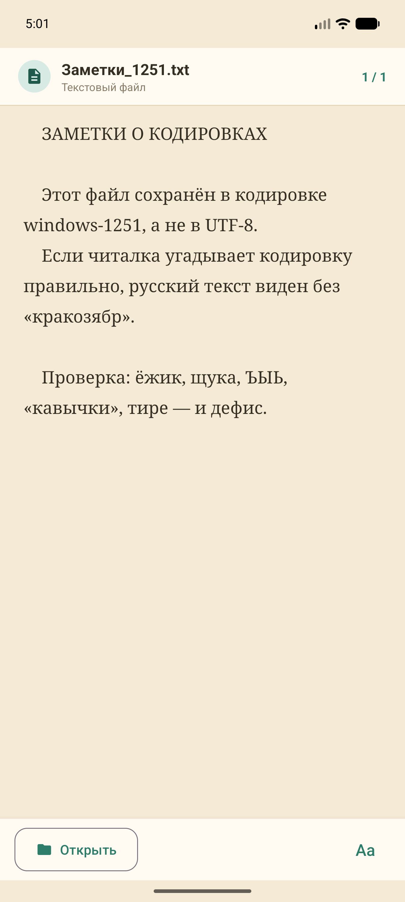
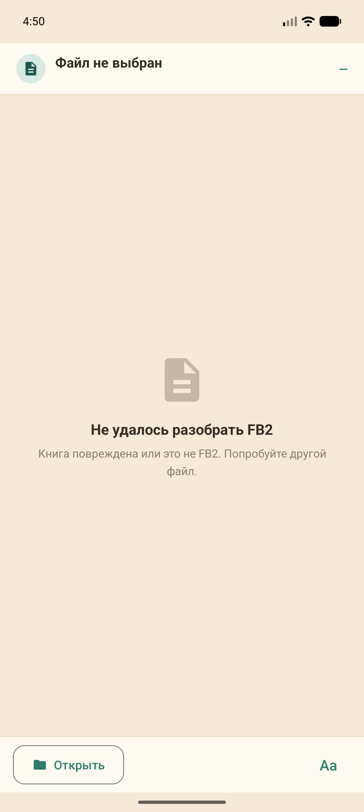
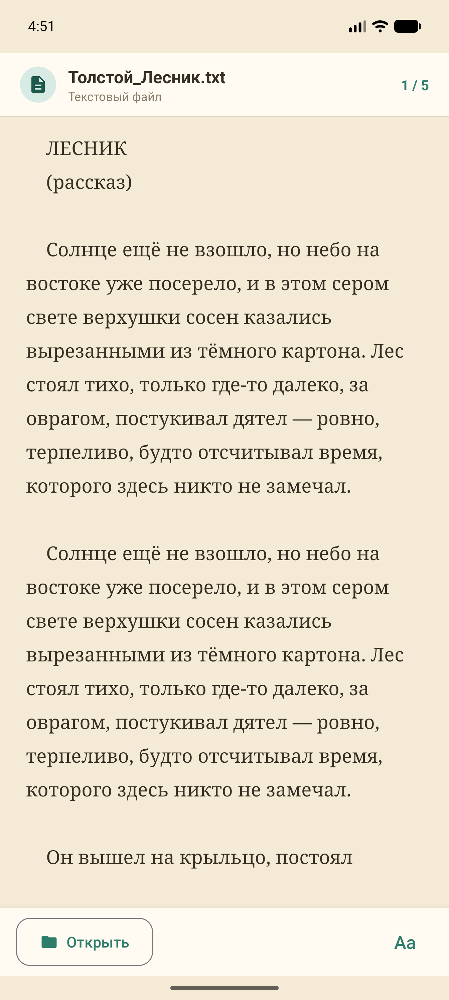
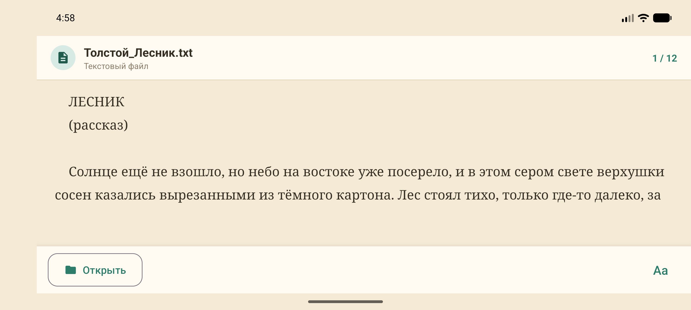

# Страницы — читалка с постраничной вёрсткой

Android-приложение, которое открывает текстовый файл или книгу FB2 и раскладывает текст
**по страницам**, как в бумажной книге. Листать можно свайпом или касанием у края экрана.

**Стек:** Kotlin · Material 3 · ViewPager2 · ViewModel · Coroutines · minSdk 24 · targetSdk 36

<p align="center">
  
</p>

---

## Чем это отличается от обычной читалки

Вместо одного длинного `TextView` внутри `ScrollView` текст заранее разбивается на страницы,
и каждая страница — это отдельный фрагмент в `ViewPager2`. Такой подход даёт «книжное» листание
и точный счётчик страниц, но требует считать вёрстку вручную — этим занимается `Paginator`.

---

## Возможности

- **Открытие файла** через системный диалог (`ActivityResultContracts.OpenDocument`) —
  разрешения на доступ к памяти не нужны.
- **Постраничная вёрстка**: текст измеряется `StaticLayout` с теми же шрифтом и шириной,
  что и на экране, а затем строки группируются в страницы по высоте.
- **Листание** свайпом, касанием правой половины страницы (вперёд) и левой (назад).
- **Счётчик страниц** в шапке: «3 / 12».
- **Размер шрифта** от 12 до 30 sp через диалог с ползунком и живым примером; после изменения
  страницы пересчитываются, а место чтения сохраняется.
- **Обработка ошибок**: пустой файл, повреждённый FB2, нет доступа, слишком большой файл.
- **FB2**: свой разбор в список блоков — заголовки по центру и крупнее, абзацы с красной строкой,
  эпиграфы курсивом.
- **Кодировки**: UTF-8 / UTF-16 по BOM, иначе проверка строгим UTF-8, и если не сходится —
  windows-1251.
- **Поворот экрана**: страницы пересчитываются под новую площадь, позиция сохраняется.

---

## Скриншоты

| Пустой экран | Книга FB2 |
|---|---|
|  |  |

| Настройка шрифта | Кодировка windows-1251 |
|---|---|
|  |  |

| Ошибка разбора FB2 | Обычный .txt |
|---|---|
|  |  |

| Ландшафтная ориентация |
|---|
|  |

---

## Как это устроено

```
BookLoader  ──►  BookDocument (список Block: Title / Paragraph / Epigraph / Divider)
                        │
                BlockRenderer ──► Spanned (жирный, курсив, отступы, выравнивание)
                        │
                  Paginator ──► List<PageSpan> (границы страниц в символах)
                        │
                ReaderViewModel ──► PageAdapter ──► PageFragment (одна страница)
```

- **`Block`** — смысловая единица текста. Оформление задаётся при отрисовке, а не зашивается
  в строку пробелами, поэтому один и тот же текст легко переоформить.
- **`Paginator`** — строит `StaticLayout` на весь текст и режет его по строкам: страница
  получается как диапазон символов, текст не дублируется в памяти.
- **`ReaderViewModel`** — хранит книгу и разбивку, поэтому при повороте экрана ничего
  не перечитывается с диска.
- **`PageFragment`** — показывает свой кусок текста; касание определяется по `MotionEvent`,
  а не по `View.getX()`, чтобы свайп продолжал работать.

Файлы:

```
app/src/main/java/com/example/pagereader/
├── MainActivity.kt        — экран, выбор файла, состояния, диалог шрифта
├── ReaderViewModel.kt     — книга, страницы, текущая позиция
├── PageAdapter.kt         — адаптер ViewPager2
├── PageFragment.kt        — одна страница + обработка касаний
├── Paginator.kt           — разбивка текста на страницы
├── BlockRenderer.kt       — оформление блоков
├── BookLoader.kt          — чтение файла и определение кодировки
├── Fb2BlocksParser.kt     — разбор FB2 в блоки
└── Block.kt               — модель документа
```

---

## Как запустить

### Готовый APK (без Android Studio)

Страница [**Releases**](https://github.com/abrtro22-creator/paged-reader/releases/latest) →
скачать `PagedReader-debug.apk` → открыть на телефоне (Android 7.0+) → разрешить установку
из неизвестного источника.

### Из исходников

> ⚠️ Путь к папке проекта не должен содержать кириллицу, иначе сборка на Windows упадёт
> с ошибкой «Your project path contains non-ASCII characters».

```bash
./gradlew assembleDebug
# app/build/outputs/apk/debug/app-debug.apk
```

В Android Studio: `File → Open` → папка проекта → дождаться Gradle Sync → `Run ▶`.

---

## Тестовые файлы

В папке [`testdata`](testdata):

| Файл | Что проверяет |
|---|---|
| `sample_utf8.txt` | обычный текст, постраничная разбивка, шрифт |
| `sample_cp1251.txt` | автоопределение windows-1251 |
| `sample.fb2` | разбор FB2: заголовки, эпиграф, абзацы с отступом |
| `empty.txt` | ошибка «Файл пустой» |
| `broken.fb2` | ошибка «Не удалось разобрать FB2» |
| `no_text.fb2` | FB2 без текста |

---

## Что проверено на эмуляторе (Android 16, API 36)

- запуск, пустое состояние;
- открытие .txt и .fb2 — корректная разбивка на страницы (FB2: 3 страницы, после увеличения
  шрифта — 6);
- листание свайпом и касанием у края, счётчик страниц;
- диалог размера шрифта, пересчёт страниц с сохранением места чтения;
- пустой файл и повреждённый FB2 — понятные сообщения, без падений;
- windows-1251 — текст без «кракозябр»;
- поворот экрана — страницы пересчитываются (5 → 12 страниц), позиция сохраняется.
